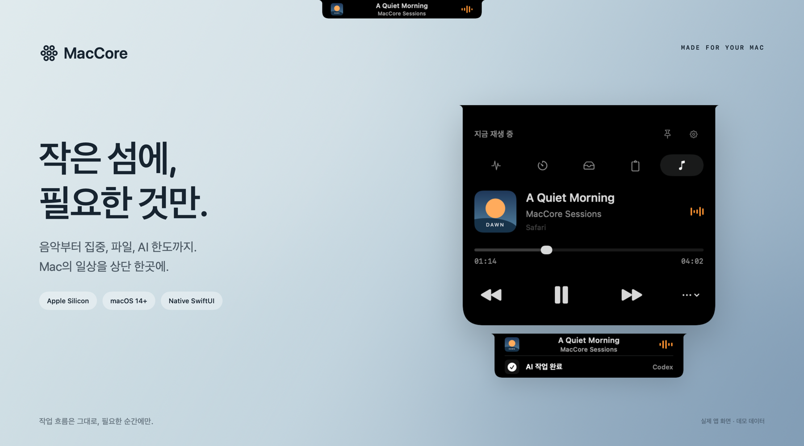
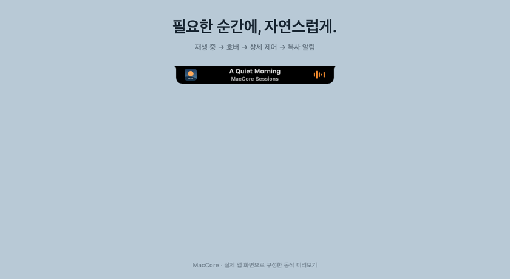
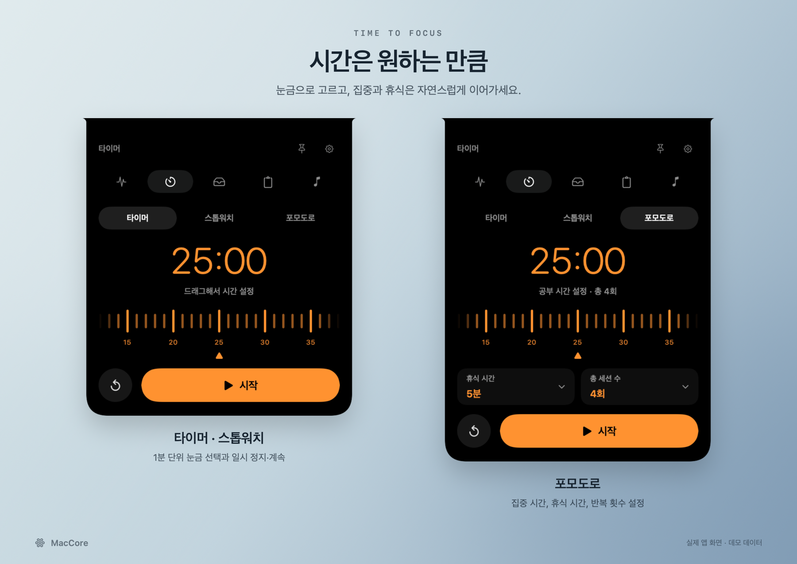
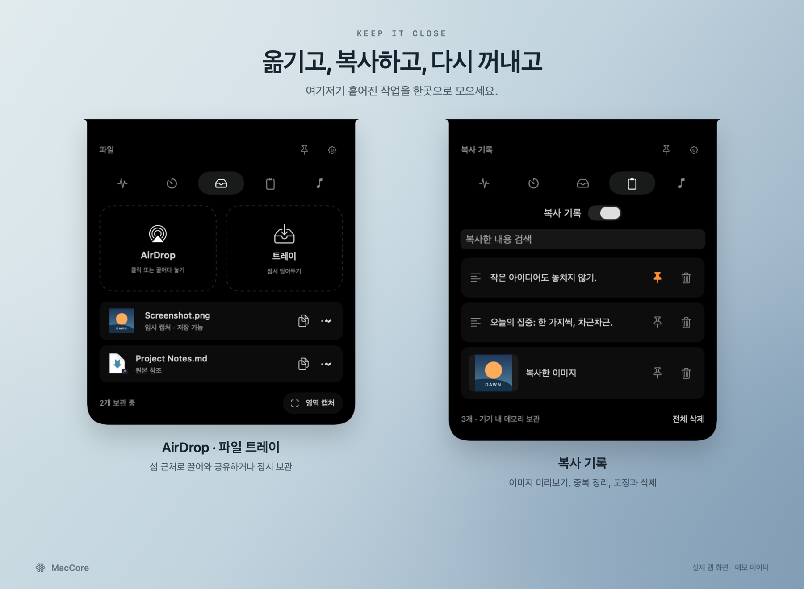
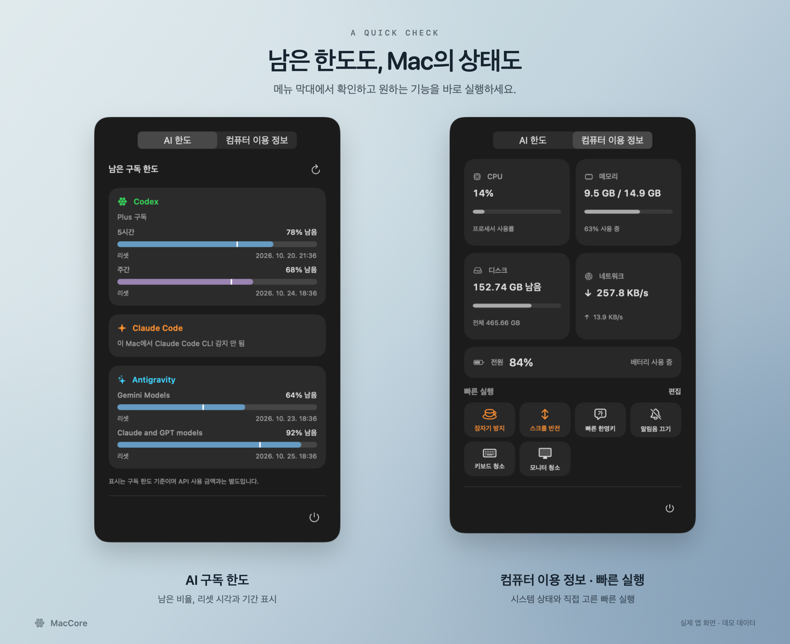

  

<h1 align="center">MacCore</h1>

  <strong>Mac 상단의 작은 섬, 매일 쓰는 도구를 한곳에.</strong> 
  음악, 집중 시간, 파일, 복사 기록과 AI 구독 한도를 
  작업 중인 화면을 벗어나지 않고 확인하세요.

  <kbd>Apple Silicon</kbd> &nbsp; <kbd>macOS 14+</kbd> &nbsp; <kbd>SwiftUI + AppKit</kbd>

  <a href="https://github.com/jmh0106/MacCore/releases/tag/v0.2.0"><strong>MacCore 다운로드</strong></a> ·
  <a href="#미리보기">미리보기</a> ·
  <a href="#주요-기능">주요 기능</a> ·
  <a href="#설치">설치</a> ·
  <a href="#자주-묻는-질문">FAQ</a>

## 미리보기

평소에는 작게, 필요한 순간에는 넉넉하게. 재생 중인 음악 위에 마우스를 올리면 살짝 커지고, 클릭하면 상세 제어가 펼쳐집니다. 음악이나 타이머가 진행 중일 때는 복사·스크린샷·완료 알림이 그 아래에 한 줄로 나타납니다.

  

> 이미지와 GIF는 실제 앱 뷰에 데모 데이터를 넣어 제작했습니다. 표시된 음악·파일·복사 내용·사용량은 예시입니다.

## 주요 기능

### 지금 재생 중인 음악을, 바로 여기서

특정 음악 앱을 따로 연결할 필요 없이 macOS가 제공하는 현재 재생 정보를 따라갑니다. 앨범 이미지와 곡 정보를 확인하고, 재생·일시 정지·이전·다음 곡·재생 위치를 제어할 수 있습니다.

노치가 없는 Mac에서도 상단 중앙의 작은 MacCore 섬을 사용할 수 있습니다.

### 집중할 시간만큼, 내 방식대로

타이머와 포모도로 모두 눈금을 움직여 **1~180분** 사이에서 공부·작업 시간을 고를 수 있습니다. 포모도로는 휴식 시간과 총 횟수를 설정하면 집중과 휴식을 이어줍니다. 스톱워치, 일시 정지·계속, 완료 알림도 함께 제공합니다.

### 파일과 복사 기록을 가까이에

파일을 상단 섬 **주변으로 끌어오면** AirDrop과 트레이가 나타납니다. 파일을 잠시 담았다가 다른 앱으로 꺼내거나, 영역 캡처와 새 스크린샷을 모아둘 수 있습니다.

복사 기록에서는 텍스트와 이미지 미리보기를 확인하고 검색·다시 복사·고정·삭제할 수 있습니다. 같은 내용을 여러 번 복사해도 기존 항목으로 합쳐 정리합니다.

### 남은 AI 한도와 Mac 상태를 한눈에

메뉴 막대에서 **AI 한도 / 컴퓨터 이용 정보**를 선택하세요. AI 한도는 남은 비율과 리셋 날짜·시각을 보여주며, 막대의 흰 선은 리셋까지 남은 기간의 위치를 나타냅니다. 컴퓨터 이용 정보에서는 CPU·메모리·디스크·네트워크·배터리 상태를 확인할 수 있습니다.

| 연동 | 남은 구독 한도 | AI 작업 완료 알림 |
| :--- | :--- | :--- |
| **Codex** | 5시간·주간 한도와 리셋 시각 | 로컬 완료 신호 연동·macOS 완료 배너 감지 |
| **Antigravity** | 모델 그룹별 한도와 리셋 시각¹ | macOS 완료 배너 감지 |
| **Claude Code** | 현재 CLI 감지만 지원, 구독 한도 조회 미지원 | macOS 완료 배너 감지 |

¹ 사용량 표시는 로그인된 호환 로컬 CLI가 필요합니다. API 결제 금액이나 정확한 토큰 개수가 아닌 **구독 잔여 한도**를 표시하며, 서비스가 제공하는 정보에 따라 항목이 달라질 수 있습니다. macOS 완료 배너 감지에는 해당 도구의 알림이 켜져 있어야 합니다. Codex의 로컬 완료 신호 방식은 별도 후크 설정이 필요합니다([연동 형식](docs/DEVELOPMENT.md#ai-완료-신호)).

### 자주 쓰는 기능은 빠른 실행으로

**컴퓨터 이용 정보 → 빠른 실행 → 편집**에서 원하는 기능과 앱을 추가하세요. 켜진 토글 기능은 주황색으로 표시합니다.

| 기능 | 동작 |
| :--- | :--- |
| 잠자기 방지 | 1시간 동안 시스템 자동 잠자기 방지 |
| 스크롤 반전 | 시스템의 자연스러운 스크롤 방향 전환 |
| 빠른 한영키 | Caps Lock(한/A)을 F19로 연결해 등록된 입력 소스를 즉시 순환. Seamtype 같은 외부 입력기도 포함 |
| 알림음 끄기 | 미디어 음량을 유지한 채 macOS 알림·효과음 음량만 끄고 이전 음량으로 복원 |
| 키보드·모니터 청소 | 30초 청소 모드 |
| 앱 바로가기 | 직접 고른 앱을 한 번에 실행 |

## 설치

**M칩 Mac · macOS 14 이상**을 대상으로 합니다. Intel Mac용 바이너리는 제공하지 않습니다.

현재 **0.2.0 프리뷰**입니다. [Releases에서 DMG를 다운로드](https://github.com/jmh0106/MacCore/releases/tag/v0.2.0)한 뒤, 디스크 이미지를 열고 **MacCore를 Applications 폴더로 끌어 넣으세요**. Xcode 없이 사용할 수 있습니다. 0.2.0부터 설정에서 업데이트를 확인할 수 있습니다.

배포본은 유료 Developer ID 서명·공증을 받지 않았습니다. 처음 실행 시 아래의 macOS 보안 안내를 확인하세요. macOS 14~26에서는 실기기 검증이 더 필요합니다.

<strong>Xcode에서 직접 빌드하기</strong>

1. 소스를 내려받고 `MacCore.xcodeproj`를 Xcode에서 엽니다.
2. 기본 ad-hoc 서명으로 빌드하거나, **MacCore → Signing & Capabilities**에서 본인의 Team과 사용 가능한 서명 인증서를 선택합니다. 고정된 개발 인증서를 쓰는 방법은 [개발 안내](docs/DEVELOPMENT.md)를 참고하세요.
3. Scheme은 **MacCore**, 실행 대상은 **My Mac**으로 선택합니다.
4. **⌘R**로 빌드하고 실행합니다.

SwiftUI + AppKit으로 만들었으며, 최초 빌드 시 [MediaRemoteAdapter](https://github.com/ejbills/mediaremote-adapter) 패키지를 내려받습니다. Xcode 27 / macOS 27의 Apple Silicon 환경에서 빌드와 실행을 확인했습니다. macOS 14~26에서는 실기기 검증이 더 필요합니다.

자세한 구조와 검사 방법은 [개발 안내](docs/DEVELOPMENT.md)를 참고하세요.

<strong>다운로드한 앱의 실행·보안 안내</strong>

1. DMG 안의 `MacCore.app`을 **Applications(응용 프로그램)** 폴더로 옮깁니다.
2. 앱을 실행하고 상단 중앙의 섬 또는 메뉴 막대 아이콘을 확인합니다.
3. 필요한 기능만 설정에서 켭니다.

현재 빌드는 Developer ID 공증을 받지 않았으므로 처음 실행할 때 macOS 경고가 나타날 수 있습니다. 출처를 확인한 배포본에 한해 [Apple의 앱 실행 안내](https://support.apple.com/ko-kr/102445)를 따라 **시스템 설정 → 개인정보 보호 및 보안 → 그래도 열기**를 사용할 수 있습니다. 서명 신원이나 설치 경로가 달라지면 권한 재승인이 필요할 수 있습니다.

### 처음 사용할 때

| 하고 싶은 일 | 방법 |
| :--- | :--- |
| 섬 열기 | 상단 중앙에 마우스를 올리거나 **⌃⌥Space** |
| 음악 상세 제어 | 재생 중인 음악 바 클릭 |
| 패널 유지 | 핀 버튼으로 고정, **Esc**로 닫기 |
| 설정 열기 | 섬의 톱니 버튼 또는 **⌘,** |
| 복사 기록 사용 | **설정 → 복사 기록 → 복사 기록 사용** 켜기. 이후 실행에도 켜짐 유지 |
| 다른 앱·AI 완료 알림 | **설정 → 알림**에서 켜고 필요한 손쉬운 사용 권한 허용 |
| 빠른 실행 구성 | 메뉴 막대 아이콘 → **컴퓨터 이용 정보 → 편집** |

화면 캡처에는 macOS 화면 기록 권한이 필요할 수 있습니다. 권한은 해당 기능을 사용할 때만 허용하면 됩니다.

## 자주 묻는 질문

<strong>복사한 내용이나 알림은 어디에 저장되나요?</strong>

복사 기록은 이 Mac의 앱 데이터 폴더에 저장되며 앱을 다시 열어도 유지됩니다. 화면 잠금 중에는 기록을 멈춥니다. 고정하지 않은 기록은 7일이 지나면 다음 복사 시 정리됩니다. 최대 100개·전체 약 32MB, 개별 이미지 5MB까지 보관하며, 고정 항목이 한도를 채우면 새 항목이 보관되지 않을 수 있습니다.

클립보드의 민감 정보 표시와 제외 앱 목록을 확인하지만 모든 비밀 정보를 자동 판별하지는 못합니다. 다른 앱 알림은 새로 표시되는 배너만 잠시 읽고, 내용이나 이력을 저장하지 않습니다. MacCore 자체 수집 서버는 없습니다.

<strong>파일 트레이는 원본 파일을 옮기나요?</strong>

일반 파일은 원래 위치에 두고 참조합니다. 트레이에서 제거해도 원본은 삭제되지 않습니다. 목록은 현재 실행 중에만 유지됩니다. 임시 영역 캡처는 종료 전에 별도로 저장하세요.

자동 스크린샷 감지는 Spotlight 인덱싱 상태와 저장 위치에 영향을 받습니다. Dock 다운로드 스택에서 직접 끄는 동작은 일관되게 지원되지 않으므로 Finder에서 끌어오거나 파일 선택 버튼을 사용하세요.

<strong>모든 플레이어와 알림을 지원하나요?</strong>

미디어는 macOS에 재생 정보를 제공하는 앱을 따라갑니다. 이미지·재생 길이·제어 명령은 플레이어가 제공하는 범위에 따라 달라지고, 여러 앱이 재생 중이면 시스템이 선택한 한 대상을 표시합니다. 재생 연동에는 비공개 MediaRemote 기능을 사용하므로 macOS 업데이트로 호환성이 달라질 수 있습니다.

알림 감지는 macOS 접근성 UI와 알림 문구에 영향을 받습니다. 알림음 끄기는 시스템 알림·효과음 음량을 조절하며, 앱이 자체 미디어로 재생하는 소리까지 차단하지는 않습니다.

<strong>빠른 한영키를 끄면 원래대로 돌아오나요?</strong>

빠른 한영키를 끄거나 MacCore를 정상 종료하면 기존 Caps Lock 매핑을 복원합니다. 다른 키의 매핑은 유지합니다. F19를 이미 다른 단축키에서 사용 중이거나 macOS가 키보드 접근을 허용하지 않으면 오류를 표시합니다.

---

문제를 제보할 때는 **macOS 버전 · Mac 모델 · 재현 순서**를 함께 적어주세요. 스크린샷에 계정이나 복사한 내용이 보이지 않는지도 확인해 주세요.

재생 정보 연동: [MediaRemoteAdapter](https://github.com/ejbills/mediaremote-adapter). MacCore는 Apple 및 각 AI 서비스의 공식 제품이 아닙니다.
